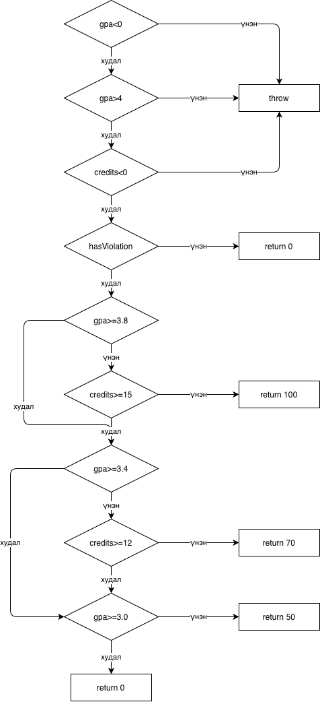

# Лаб 9: Код хамралт (JaCoCo)

Нэр: Сайнзаяа
Оюутны код: B252270209

## Орчин

`java -version` ба `mvn -version` гаралт (`results/env-versions.txt`):

```
openjdk version "25.0.2" 2026-01-20 LTS
OpenJDK Runtime Environment Temurin-25.0.2+10 (build 25.0.2+10-LTS)
OpenJDK 64-Bit Server VM Temurin-25.0.2+10 (build 25.0.2+10-LTS, mixed mode, sharing)
WARNING: A restricted method in java.lang.System has been called
WARNING: java.lang.System::load has been called by org.fusesource.jansi.internal.JansiLoader in an unnamed module (file:/Users/tselmuunzaya/tools/apache-maven-3.9.9/lib/jansi-2.4.1.jar)
WARNING: Use --enable-native-access=ALL-UNNAMED to avoid a warning for callers in this module
WARNING: Restricted methods will be blocked in a future release unless native access is enabled

Apache Maven 3.9.9 (8e8579a9e76f7d015ee5ec7bfcdc97d260186937)
Maven home: /Users/tselmuunzaya/tools/apache-maven-3.9.9
Java version: 25.0.2, vendor: Eclipse Adoptium, runtime: /Library/Java/JavaVirtualMachines/temurin-25.jdk/Contents/Home
Default locale: en_MN, platform encoding: UTF-8
OS name: "mac os x", version: "26.5.2", arch: "aarch64", family: "mac"
```

## A: Happy path тестүүд ба эхний хэмжилт

5 тест бичсэн (`letterGradeA`, `letterGradeB`, `gpaTwoScores`, `scholarshipFull`, `scholarshipSeventy`). Гаралт: `results/mvn-verify-A.txt`, `results/jacoco-A.csv`.

- Line: 15/25 = 60%
- Branch: 20/41 ≈ 49%

Ажиглалт: Хэвийн урсгалын тестүүд зөвхөн A, B дүн болон 100, 70 хувийн тэтгэлгийг дайрсан. Тиймээс `letterGrade`-ийн C, D, F буцаалт, бүх `throw new IllegalArgumentException` мөрүүд, `gpa()`-ийн null/хоосон шалгалт, `scholarship()`-ийн `hasViolation` болон 50/0 хувийн замууд хүрээгүй (улаан). Нөхцөл бүрийн зөвхөн нэг талаар (үнэн эсвэл худал) орсон `if`-үүд хагас хамрагдсан (шар ромбо) болсон. Жишээ нь `gpa >= 3.8 && credits >= 15`.

## B: CFG зурж branch 100% хүрэх

`scholarship()` функцийн CFG-г гараар зурсан (draw.io). Ирмэг бүр дээр түүнийг дайрах тестийн нэрийг бичсэн.



Нийт 22 тест шаардагдсан (`results/mvn-verify-B.txt`: `Tests run: 22`). `results/jacoco-B.csv` дээр `BRANCH_MISSED = 0`, `LINE_MISSED = 0` (Branch 41/41, Line 25/25).

Анхаарсан зүйлс: `gpa()`-ийн `default` (F дүн) салаа, `scholarship()`-ийн `&&` нөхцөл бүрийн худал утга (голч хангасан ч кредит дутуу), мөн эхний `if (gpa < 0 || gpa > 4 || credits < 0)`-ийн нөхцөл тус бүрт тусдаа `assertThrows` тест (`scholarshipNegativeGpaThrows`, `scholarshipGpaOver4Throws`, `scholarshipNegativeCreditsThrows`).

## C: Давталтын заагийн тестүүд

`gpa()` доторх давталтад 0 / 1 / 2+ дүрмийг хэрэгжүүлсэн:

- 0 удаа: `gpaEmptyThrows` (хоосон массив), `gpaNullThrows` (null)
- 1 удаа: `gpaSingleScore`, `gpa([95]) == 4.0`
- 2+ удаа: `gpaManyScores`, `gpa([95, 85, 75, 65]) == 2.5`

Эдгээр нэмсний дараа 24 тест (`results/mvn-verify-C.txt`).

Хамралт өсгөдөггүй ч яагаад хэрэгтэй вэ: Хамралтын хэрэгсэл давталтын мөр, салаа нэг удаа ажилласан эсэхийг л тоолдог, нийлбэр болон голчийн утга зөв эсэхийг шалгадаггүй. 0/1/2+ тестүүд давталт хоосон, нэг дүнтэй, олон дүнтэй үед үр дүн зөв гарч байгааг assert-ээр шалгаж, нийлбэр эсвэл хуваагчийн алдааг илрүүлдэг.

## D: Хамралт 100%, гэхдээ алдаа амьд

Спецификаци: 60-69.99 оноо "D". Зааг утгын 7 тест нэмсэн (`60`, `59.99`, `69.99`, `0`, `100`, `89.99`, `90`), нийт 31 тест.

`mvn test` ажиллуулахад 1 тест унасан (`results/mvn-test-D-fail.txt`):

```
ScholarshipCalculatorTest.boundary60IsD:41 expected: <D> but was: <F>
```

Алдаа: `letterGrade` доторх `if (score > 60) return "D";`. Спецификацаар 60 нь D байх ёстой тул оператор нь `>=` байх ёстой. Тусдаа commit-оор засав (`c1a5f5a`, "Fix letterGrade: > 60 -> >= 60, spec says 60 is D"). Засварын дараа 31 тест ногоон, Branch ба Line 100% хэвээр (`results/mvn-verify-final.txt`, `results/jacoco-final.csv`).

### Гол дүгнэлт

Branch хамралт 100% байсан ч энэ алдаа тестэд баригдалгүй амьд үлдсэн. Учир нь `score > 60` ба `score >= 60` хоёр хоёулаа үнэн/худал гэсэн ижил хоёр салаа үүсгэдэг. 65 оноо үнэн салаа руу, 30 оноо худал салаа руу орвол хоёр салаа хоёулаа "хамрагдсан" болдог. Зөвхөн яг 60 гэсэн заагийн утга л хоёр операторын ялгааг илрүүлнэ. Хамралт нь тестийн ажиллуулсан код, салааг хэмждэг боловч тестийн утга спецификацитай таарч байгааг (oracle) хэмждэггүй. Иймээс хамралт зайлшгүй хэрэгтэй боловч хангалттай нотолгоо биш, зааг утгын тест хамт хэрэгтэй.

## AI ашигласан хэсэг

AI туслахыг дараах хоёр зүйлд ашигласан:

- Орчин тохируулахад (Maven суулгах, JaCoCo-г Java 25-д тохируулж 0.8.12-оос 0.8.14 болгох) тусламж авсан.
- Тестийн код болон тестийн бүтцийг бичихэд AI-аас тусламж авсан.

## Ажиллуулах

```
mvn verify
```

JaCoCo тайлан: `target/site/jacoco/index.html`. Хамралтын тоо `target/site/jacoco/jacoco.csv` файлаас гарна.
